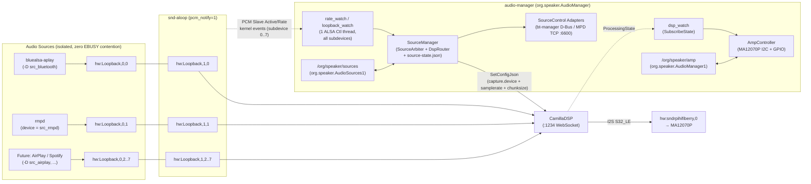

# Multi-Source Audio Plan for `audio-manager`

> **Status:** Phase 0 live verification **completed 2026-11-26** — ready for Phase 1 implementation.
> **Decisions locked:**
> 1. **Default auto-switch policy:** `last-play` (`LastPlayWins`).
> 2. **Volume ownership:** `audio-manager` remains the sole amplifier volume owner; bidirectional `rmpd` ↔ `audio-manager` volume sync (gated on `ActiveSource == "rmpd"`) is planned for **Phase 2** alongside `bt-manager`'s `ActiveSource`-gated volume sync.
> 3. **Reboot persistence:** Persist `last_source`, `pinned_source`, and `auto_switch_policy` atomically to `/var/lib/speaker/source-state.json` and restore `last_source` on boot.

## 0. Phase 0 Live Verification Results (Pi `192.168.2.120`, 2026-11-26)

All checks ran non-destructively and restored original Pi state (`hw:Loopback,1,0`, `48000 Hz`, `Paused`):

1. **`snd-aloop` multi-subdevice isolation (`hw:Loopback` `device=1`):**
   - Enabling `PCM Notify` on `iface=PCM,device=1,subdevice=1` while CamillaDSP held `hw:Loopback,1,0` open fired immediate ALSA ctl `VALUE` events (`(3,1,1,PCM Slave Active,0)`) on open/close of `hw:Loopback,0,1`.
   - `PCM Slave Active` (`device=1,subdevice=1`) flipped `off → on → off` and `PCM Slave Rate` reported `44100` while `subdevice=0` remained `off`.
   - **Important note:** When `PCM Slave Active` is `off`, `snd-aloop` defaults `PCM Slave Rate` to `48000` (not `0`), so `active` must always gate routing decisions.
2. **CamillaDSP 5.0.0-beta.2 live `capture.device` switching (`ws://127.0.0.1:1234`):**
   - `SetConfigJson` with `"device": "hw:Loopback,1,1"` and `"samplerate": 44100` returned `{"reply":"SetConfigJson","result":"Ok"}` without restarting `camilladsp.service`; subsequent `GetConfigJson` confirmed `hw:Loopback,1,1` at `44100`.
   - **Important note:** `SetConfigJson` applies asynchronously while the engine transitions through `Starting`: an immediate `GetConfigJson` after `SetConfigJson` can still return the previous config until `Starting` settles. `reconcile_with_engine` must skip divergence checks while `status.state == ProcessingState::Starting` (or within a short post-write settle window) to avoid duplicate pushes.
3. **MPD TCP control (`127.0.0.1:6600`, `rmpd` reporting `OK MPD 0.24.0`):**
   - `pause 1`, `status`, `getvol`, `setvol`, `idle`, and `commands` are all supported over local TCP with zero auth needed on loopback.
4. **`rmpd` `mixer_type` behavior:**
   - Embedded `rmpd` output docs & strings confirm only **`software | hardware | none`** are implemented (no `"null"` virtual mixer). With `mixer_type = "none"`, `setvol 50` returns `ACK [52@0] {setvol} problems setting volume`.
   - **Phase 2 implication:** Either keep `mixer_type = "none"` (no double attenuation; volume via rotary encoder / `screen-manager` / D-Bus) or add a non-attenuating `"null"`/`"external"` mixer option in `rmpd` before enabling `rmpd` ↔ `audio-manager` volume sync.

---

## 1. Current State Audit (Docs, Code & Live Pi)

| Component | Current Implementation | Multi-Source Gap |
|---|---|---|
| **ALSA Routing** (`baseline/etc/asound.conf`) | `pcm.!default` → `plug` → `hw:Loopback,0,0` (single exclusive subdevice). Both `bluealsa-aplay -D default` and `rmpd` (`device = "default"`) target it. | **Hard `EBUSY` collision:** whichever source opens `hw:Loopback,0,0` first locks the other out. No seamless handover is possible. |
| **Sample-Rate Watcher** (`services/audio-manager/src/rate_watch.rs`) | Hardcodes `LOOPBACK_SUBDEVICE = 0` (`hw:Loopback,1,0`) and directly calls `CamillaDSP` `SetConfigJson` updating only `samplerate` + `chunksize`. | Blind to other loopback subdevices (`1..7`); cannot switch `devices.capture.device`; would fight any source router over `SetConfigJson`. |
| **DSP Lifecycle Watcher** (`services/audio-manager/src/dsp_watch.rs`) | Subscribes to CamillaDSP `ProcessingState` and sends `StreamStarting` / `StreamStopping` to `AmpController`. | Already source-agnostic (works cleanly as long as CamillaDSP switches inputs). |
| **Amp Controller** (`services/audio-manager/src/amp_controller.rs`) | Sole owner of MA12070P I2C + GPIO, pop-free PLL-lock handshake, and persisted `AmpState`. | Already source-agnostic (per `docs/audio_manager_plan.md` §2 & §7: handover must **never** touch amp volume/mute). |
| **D-Bus API** (`services/audio-manager/src/dbus_api.rs`) | Exposes only `/org/speaker/amp` (`org.speaker.AudioManager1`: `SetLevel`, `SetMute`, `Level`, `Muted`). | No API to inspect registered sources, observe `ActiveSource`, manually select/pin a source, or set auto-switch policy. |
| **D-Bus Bus Policy** (`/etc/dbus-1/system.d/org.speaker.AudioManager.conf`) | Live on Pi (root-only policy), missing from `baseline/etc/dbus-1/system.d/`. | Missing from git `baseline/`; lacks `<policy context="default">` for non-root signal/property readers. |
| **Bluetooth Volume Sync** (`services/bt-manager/src/volume_sync.rs`) | Always syncs `BlueALSA ↔ audio-manager` whenever a BT device is connected. | **Volume hijack:** a connected phone adjusting volume while `rmpd` is playing will overwrite the speaker's volume. |
| **Bluetooth Arbiter** (`services/bt-manager/src/active_source.rs`) | Arbitrates BT-vs-BT via `org.speaker.Bluetooth1` (`ActiveDevice`), with internal helpers `pause_remote_player` and `release_lingering_a2dp`. | Exposes no D-Bus method for `audio-manager` to pause/yield the active BT source when another source takes over. |
| **rmpd Daemon** (`~/.config/rmpd/rmpd.toml`) | Live on Pi (`OK MPD 0.24.0` on `127.0.0.1:6600`, `mixer_type = "none"`, `device = "default"`). | Needs dedicated `src_rmpd` (`hw:Loopback,0,1`) output and Phase 2 bidirectional volume sync gated on `ActiveSource == "rmpd"`. |

> **Verified live on Pi (`2026-11-26`):** `amixer -c Loopback controls` confirms `snd-aloop` already exposes per-subdevice `PCM Notify`, `PCM Slave Active`, and `PCM Slave Rate` controls for `subdevice=0..7` on `device=1`, and `DspConfigInfo` in `crates/dsp/src/client.rs` already parses `CaptureDevice::Alsa { device, .. }` into `capture_device: Option<Box<str>>`.

---

## 2. Target Architecture

### Core Design Principle: Dedicated Loopback Subdevice Per Source + Single CamillaDSP Writer

Each ALSA-based source writes to its **own `snd-aloop` subdevice** (via named ALSA aliases in `/etc/asound.conf`). Direct hardware inputs (future USB/line-in ADC) are also first-class capture devices.



---

## 3. Plan Review Refinements & Edge-Case Resolutions

1. **Idle Loopback Subdevices & `stop_on_inactive: true`:**
   - In `snd-aloop`, an idle subdevice (`PCM Slave Active == false`) has `rate_hz == 0` (or stale rate), and `crossover.yml` sets `stop_on_inactive: true`.
   - **Rule:** Restoring `last_source` on boot or calling `SelectSource(B)` when `B` is idle sets `active = Some(B)` logically (updating D-Bus `ActiveSource` and persisted `source-state.json`), and pauses any displaced streaming source `A`.
   - `DspRouter` only pushes `SetConfigJson` when the active source is **streaming with `rate_hz > 0`** (or when switching *away* from a streaming source `A` to an idle source `B` so CamillaDSP immediately detaches from `A`'s subdevice and enters `Inactive`, silencing `A` even before `A`'s async pause finishes).
2. **Displaced-Source Lingering Stream Race (`LastPlayWins`):**
   - When `B` (`rmpd`) starts streaming while `A` (`bluetooth`) is active, `SourceArbiter` hands over to `B` and emits `pause_sources = vec![A]`.
   - While `A`'s pause is in flight (or if a laptop lingers `Running: true` sending silence), `A`'s subdevice remains `active == true`.
   - **Rule:** `LastPlayWins` triggers **strictly on a `false → true` streaming edge** (`!was_streaming && now_streaming`). Steady-state `active == true` readings or rate-only updates on a non-active source never steal focus back.
   - On startup seed, if multiple subdevices are already streaming simultaneously, pick deterministically (preferring persisted `last_source` if streaming, else highest `priority`) and return `pause_sources: Vec<SourceId>` for all other streaming sources.
3. **Zero-Duplication Evolution of `rate_watch.rs` (`AGENTS.md` §4.2):**
   - Do not duplicate `rate_watch.rs` into a separate copy. Generalize `build_reconfigured_config_json` and `RateWatchController` to track `(capture_device: Box<str>, rate_hz: u32)` (mutating `CaptureDevice::Alsa { ref mut device, .. }` alongside `samplerate` and `chunksize`), keeping existing `rate_watch` helpers thin wrappers or re-exports.
4. **Export `/org/speaker/sources` Before `sd_notify(READY=1)`:**
   - Export both `/org/speaker/amp` and `/org/speaker/sources` on the system bus *before* calling `sd_notify(READY=1)` so dependent services (`bt-manager`, `screen-manager`) ordered `After=audio-manager.service` never race object registration.
5. **Host-First `rmpd` Volume Sync Placement (Phase 2):**
   - Because `rmpd` is a standalone binary (`127.0.0.1:6600`) with no separate manager daemon, Phase 2's MPD volume-sync task belongs directly inside `audio-manager` (talking to `127.0.0.1:6600` via MPD `idle mixer` / `status` / `setvol` and dispatching `AmpCommandKind::SetLevel` internally when `ActiveSource == "rmpd"`), avoiding an extra daemon or D-Bus hop.

---

## 4. Detailed Design (`services/audio-manager/src/sources/`)

All new modules adhere to the Microsoft Pragmatic Rust Guidelines and `AGENTS.md` (pure host-testable state machines, mockable seams via `new_mocked()`, integration tests exclusively under `services/audio-manager/tests/`).

### 4.1 Source Registry & Configuration (`config.rs`, `sources/registry.rs`)
Extend `Config` in `services/audio-manager/src/config.rs` with backward-compatible defaults (`bluetooth` → subdevice 0, `rmpd` → subdevice 1, `auto_switch_policy = "last-play"`, `source_state_path = "/var/lib/speaker/source-state.json"`):

```json
{
  "auto_switch_policy": "last-play",
  "camilladsp_config_path": "/etc/camilladsp/crossover.yml",
  "source_state_path": "/var/lib/speaker/source-state.json",
  "sources": [
    {
      "id": "bluetooth",
      "display_name": "Bluetooth",
      "priority": 50,
      "capture": { "kind": "loopback", "subdevice": 0 },
      "control": { "kind": "bluetooth_dbus" }
    },
    {
      "id": "rmpd",
      "display_name": "Music Player",
      "priority": 40,
      "capture": { "kind": "loopback", "subdevice": 1 },
      "control": { "kind": "mpd_tcp", "host": "127.0.0.1", "port": 6600 }
    }
  ]
}
```

- **Strong domain types (`M-STRONG-TYPES`):**
  - `SourceId(Box<str>)` validated at config/D-Bus boundaries (non-empty ASCII `[a-z0-9_-]`, max 32 chars).
  - `CaptureSpec` sum type: `Loopback { subdevice: u32 }` (`0..=7`) or `AlsaDirect { device: Box<str>, default_rate_hz: u32 }`.
  - `ControlSpec` sum type: `BluetoothDbus`, `MpdTcp { host: Box<str>, port: u16 }`, `None`.
  - `AutoSwitchPolicy` enum: `LastPlayWins` (default), `FirstPlayWins`, `Priority`.
- **Startup validation:** Reject empty source lists, duplicate `SourceId`s, duplicate loopback subdevice indices, or subdevices `>= 8`.

### 4.2 Pure Source Arbiter & Reboot State (`sources/arbiter.rs`, `sources/state_file.rs`)
- **Persisted state (`/var/lib/speaker/source-state.json`):**
  ```json
  {
    "last_source": "rmpd",
    "pinned_source": null,
    "auto_switch_policy": "last-play"
  }
  ```
  - Written atomically (temp file + `fsync` + `rename`).
  - **On boot:** Load `source-state.json` (falling back to config defaults if missing/corrupt). If `last_source` is still registered, set it as the initial `active` source. Under `last-play`, whichever source transitions `false → true` next takes over seamlessly (unless `pinned_source` is set).
- **Pure `SourceArbiter` state machine:**
  - Tracks per-source `(streaming: bool, rate_hz: u32, last_active_seq: u64)` plus `active: Option<SourceId>`, `last_source: Option<SourceId>`, `pinned: Option<SourceId>`, `policy: AutoSwitchPolicy`.
  - Inputs: `seed(...)`, `on_activity(id, active, rate_hz)`, `select_source(id)`, `pin_source(Option<SourceId>)`, `release_source(id)`, `set_policy(AutoSwitchPolicy)`.
  - Outputs (`ArbiterOutcome`):
    - `active_changed: Option<Option<SourceId>>` → emit D-Bus `PropertiesChanged` + persist `source-state.json`.
    - `pause_sources: Vec<SourceId>` → displaced/shut-out sources to pause asynchronously.
    - `dsp_target: Option<DspTarget { capture_device: Box<str>, rate_hz: u32, streaming: bool }>` → desired DSP routing state for the active source.

### 4.3 Multi-Subdevice Loopback Watcher & DSP Router (`rate_watch.rs` / `sources/router.rs`)
- **Multi-subdevice ALSA `Ctl` watcher:**
  - Opens **one** non-blocking `Ctl::new("hw:Loopback", true)` handle.
  - Enables `PCM Notify` on `(device=1, subdevice=N)` for every registered `CaptureSpec::Loopback { subdevice: N }`.
  - Reads `(PCM Slave Active, PCM Slave Rate)` per registered subdevice on startup and on every ALSA ctl event, emitting `LoopbackEvent { subdevice, state, from_event }`.
- **Single-writer `DspRouter`:**
  - Parses `/etc/camilladsp/crossover.yml` with `camilladsp-schema`, updates `CaptureDevice::Alsa { device, .. }`, `devices.samplerate`, and `devices.chunksize`, validates via `validate_config(&mut cfg, None)`, and calls `dsp.set_config_json_async(&json)`.
  - Confirms `(applied_device, applied_rate)` strictly after `SetConfigJson` succeeds (500 ms retry on failure).
  - Reconciles every 2 s while active against `dsp.read_status_async()`, checking **both** `status.config.capture_device` and `status.config.samplerate` (plus `ProcessingState::Inactive`) to self-heal if `camilladsp.service` restarts.

### 4.4 Pluggable Source Control Adapters & `crates/mpd` (`speaker-mpd`)
- **`crates/mpd` (`speaker-mpd`):** Shared peripheral crate wrapping `mpd_client` (`1.4.1`) behind `MpdDevice` / `MpdDeviceMock` (`new_mocked()`), `MpdHost`, `MpdPort`, `MpdStatus`, `MpdPlaybackState`, `MpdTrack`, `MpdEventStream`, and canonical `MpdError` — matching `crates/dsp` (`speaker-dsp`) and `crates/bluetooth` (`speaker-bluetooth`) for reuse across `audio-manager` (Phase 1 pause + Phase 2 volume sync) and `screen-manager` (Phase 3 Now Playing UI).
- **Trait `SourceControl: Send + Sync` (`sources/control.rs`, with `MockSourceControl`):**
  - **`BluetoothDbusControl`:** Calls `org.speaker.Bluetooth1.PauseActive()` on `/org/speaker/bluetooth` via `zbus` (2 s bounded timeout; logs at `debug!`/`warn!` if `bt-manager` is unavailable or not yet upgraded).
  - **`MpdControl`:** Wraps `speaker_mpd::MpdDevice::pause()` (`pause 1` over `127.0.0.1:6600` with 2 s bounded timeout).
  - **`NoopControl`:** For passive ALSA sources without a pause API.

### 4.5 D-Bus API Extension (`sources/dbus_sources.rs`)
Export `/org/speaker/sources` implementing `org.speaker.AudioSources1` on `org.speaker.AudioManager` (`/org/speaker/amp` stays 100% unchanged):

| Member | Kind | Signature | Description |
|---|---|---|---|
| `ActiveSource` | Property (`emits-change`) | `s` | Currently active source ID (e.g. `"bluetooth"`, `"rmpd"`), or `""`. |
| `PinnedSource` | Property (`emits-change`) | `s` | Pinned source ID, or `""` when auto-switching. |
| `AutoSwitchPolicy` | Property (`emits-change`) | `s` | `"last-play"`, `"first-play"`, or `"priority"`. |
| `Sources` | Property (`emits-change`) | `a(sssyub)` | `(id, display_name, state, priority, sample_rate_hz, is_active)`. |
| `SelectSource(id: s)` | Method | `s → ()` | Immediately switch active source to `id` (pausing previous source if streaming). |
| `PinSource(id: s)` | Method | `s → ()` | Pin to `id` (or `""` to clear pin and resume auto-switching). |
| `SetAutoSwitchPolicy(policy: s)` | Method | `s → ()` | Change policy (`"last-play"`, `"first-play"`, `"priority"`). |
| `ReleaseSource(id: s)` | Method | `s → ()` | Explicitly pause/release `id`. |

---

## 5. Cross-Service & Volume Ownership Integration (Phase 2)

### 5.1 System & Baseline Configs (`baseline/etc/`)
- **`baseline/etc/asound.conf`:** Add `pcm.src_bluetooth` (`hw:Loopback,0,0`) and `pcm.src_rmpd` (`hw:Loopback,0,1`), keeping `pcm.!default` mapped to `hw:Loopback,0,0`.
- **`baseline/etc/systemd/system/bluealsa-aplay.service`:** Point `-D default` → `-D src_bluetooth`.
- **`rmpd.toml`** (live + `baseline/` template): Point `device = "default"` → `device = "src_rmpd"`.
- **`baseline/etc/dbus-1/system.d/org.speaker.AudioManager.conf`:** Commit to `baseline/` with `<policy context="default">` allowing read/signal access to `org.speaker.AudioManager`.

### 5.2 `bt-manager` Integration (Phase 2)
1. **`org.speaker.Bluetooth1.PauseActive()`** in `services/bt-manager/src/active_source.rs`: Pauses the active BT player via `MediaPlayer1.Pause()` and disconnects lingering A2DP if the PCM stays `Running` after pause.
2. **`ActiveSource`-gated volume sync** in `services/bt-manager/src/volume_sync.rs`:
   - Subscribe to `org.speaker.AudioManager` `/org/speaker/sources` `PropertiesChanged` (`ActiveSource`).
   - Forward `BlueALSA → audio-manager` volume changes **only when `ActiveSource` is `"bluetooth"` or `""`**.
   - When `ActiveSource` transitions *to* `"bluetooth"`, arm `FRESH_PCM_SETTLE` and run `reconcile_reverse` (`amp → phone`).

### 5.3 `rmpd` Bidirectional Volume Sync (Phase 2)
- **`audio-manager` remains the sole amplifier volume owner** (never `mixer_type = "hardware"` in `rmpd`).
- **Phase 0 check:** Test `rmpd` `mixer_type` behavior so MPD clients can use `setvol 0..100` without double-attenuating PCM.
- **Implementation (inside `audio-manager`):** Event-driven `mpd_volume_sync` task over `127.0.0.1:6600` (`idle mixer` + `status` + `setvol`), forwarding `rmpd → amp` only when `ActiveSource == "rmpd"` and pushing `amp → rmpd` on `Level` changes and when `ActiveSource` switches to `"rmpd"`.

---

## 6. Phased Delivery Plan

| Phase | Scope | Verification Gate |
|---|---|---|
| **Phase 0 (Live Spike)** | Non-destructive check on Pi (`192.168.2.120`): verify `snd-aloop` subdevice 1 (`hw:Loopback,0,1` ↔ `1,1`) events while CamillaDSP captures `1,0`; verify CamillaDSP `SetConfigJson` switches `capture.device` live; verify `pause 1` over `127.0.0.1:6600`; verify `rmpd` `mixer_type` options. | Documented live results before coding. |
| **Phase 1 (`crates/mpd` + `audio-manager` PR)** | Add `crates/mpd` (`speaker-mpd` wrapping `mpd_client` with `MpdDevice::new_mocked()`, TCP tests, and `MpdEventStream`), implement `services/audio-manager/src/sources/` (`registry`, `arbiter`, `state_file`, `control`, `dbus_sources`) + generalize `rate_watch.rs` to multi-subdevice + `capture.device` routing, wire into `main.rs`, update `Config`, and add host integration tests under `services/audio-manager/tests/`. | `cargo fmt --check`, `cargo clippy --workspace --all-targets -- -D warnings`, `cargo llvm-cov ≥ 85%` (target 90%+), `aarch64` release build. |
| **Phase 2 (System + `bt-manager` + `rmpd` Volume Sync PR)** | Update `baseline/etc/asound.conf`, `bluealsa-aplay.service`, `org.speaker.AudioManager.conf`, and `rmpd.toml` template. Add `PauseActive()` + `ActiveSource`-gated `volume_sync` to `bt-manager`. Add `ActiveSource`-gated `rmpd` volume sync. Live handover & volume-isolation verification on Pi. | All CI gates + live hardware verification on Pi. |
| **Phase 3 (UI & Future Sources)** | `screen-manager` source switcher + MPD Now Playing UI; add future sources (`airplay`, `spotify`, `line_in`) via config + ALSA subdevice entry. | Separate focused PRs. |
