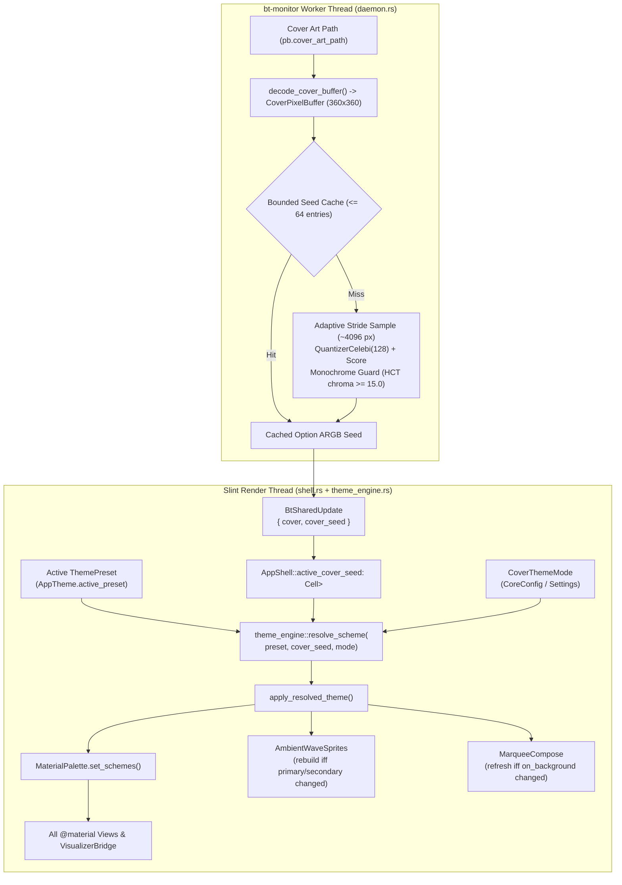

# Material 3 Dynamic Cover-Art Auto-Theming Plan

**Branch:** `feat/m3-auto-theming`  
**Worktree:** `/root/pi-bluetooth-speaker-m3-auto-theming`  
**Target Service:** `services/screen-manager` (Raspberry Pi 3B, `aarch64-unknown-linux-gnu`, 800×480 display, Slint `=1.19.0`, vendored `@material`)  
**Source Reference:** `Slint Material 3 Auto-Theming.pdf` (audited against the live codebase and `crates.io`)

---

## 1. Executive Summary

Implement Android Material You–style dynamic cover-art theming in `services/screen-manager` using Google's Material Color Utilities (`mcu-material-color = "=0.2.3"`), driving the existing writable `MaterialPalette.schemes` global directly.

Rather than replacing our 5 hand-crafted audio presets (`McIntoshBlue`, `MarantzAmber`, `CyberpunkNeon`, `StudioDark`, `Peppy`), the color engine supports a user-selectable adaptation spectrum—from exact predefined presets up to full cover-art-derived Material 3 dark schemes—while keeping all heavy pixel quantization off the Slint render thread and avoiding Pi 3 GPU/CPU frame-rate regressions.

---

## 2. Codebase Readiness & Audit Findings

The current `screen-manager` architecture already satisfies most prerequisites:

| Area | Current State | Impact on Plan |
|---|---|---|
| **Writable M3 Palette** | `ui/material/ui/styling/material_palette.slint` already exposes `in-out property <MaterialSchemes> schemes` and `ThemePreset::apply` pushes dark schemes via `set_schemes`. | No new `Theme` global or `ThemeColors` struct needed; drive `MaterialPalette.schemes` directly. |
| **Off-Thread Cover Decode** | `daemon.rs::decode_cover_buffer` already decodes & caches `.360.jpg` on the `bt-monitor` worker thread and publishes `CoverPixelBuffer` via `BtSharedUpdate`. | Run stride-sampling + `QuantizerCelebi` inside `bt-monitor` alongside decode; no separate `std::thread::spawn` or `AtomicU64` generation token needed. |
| **Crate Availability** | `cargo info mcu-material-color` confirms **`0.2.3`** (Apache-2.0) on crates.io; workspace runs `rustc 1.99.1`. | Pin `mcu-material-color = "=0.2.3"` in `[workspace.dependencies]` (gated behind `ui` feature). |
| **Settings UI Control** | `settings_view.slint` and `settings_catalog.rs` already implement `SettingControlKind::selector` (`< Prev \| Value \| Next >`). | Register `SettingId::CoverThemeMode` in `SETTINGS_CATALOG` (`SettingTier::Basic`); zero bespoke widget boilerplate. |
| **Visualizer Sync** | `ui/visualizer_bridge.rs::radial_palette()` reads `MaterialPalette` dynamically and diffs `last_radial_palette`. | Radial FFT adapts automatically. |
| **Baked CPU Pixel Buffers** | `AmbientWaveSprites` (`theme.rs`) reads `material_base_colors()` directly; `MarqueeText` (`shell.rs::refresh_marquee_strip`) bakes `MaterialPalette.on_background` (and `on_select_theme` currently omits calling it). | Centralize all theme updates through one `apply_resolved_theme` helper that updates `MaterialPalette`, rebuilds `AmbientWaveSprites` iff `(primary, secondary)` changed, and re-rasterizes the marquee strip iff `on_background` changed. |
| **Pi 3 Redraw Cost** | Full-window 800×480 redraws on VideoCore IV cost ~30 ms (~60–70% CPU at 60 Hz); `MarqueeText` strip and `AmbientWaveSprites` cannot animate via Slint `animate color`. | **Do not** attach `animate background` to `MainWindow` or `cache-rendering-hint: true` containers in the initial PR. Land instant palette updates first; evaluate tightly scoped accent animations (`<= 200ms`) separately on live Pi 3 hardware. |

---

## 3. Target Architecture



### Why Worker-Side Seed Extraction + UI-Side Resolution?
- **Zero UI thread stalls:** `QuantizerCelebi` + `Score` run exclusively on the `bt-monitor` worker right after `image::open`.
- **Instant Settings switching:** Because `AppShell` caches `active_cover_seed: Option<u32>`, toggling `CoverThemeMode` or switching `ThemePreset` in Settings recomputes `resolve_scheme(...)` in microseconds without re-reading disk or re-running quantization.
- **Zero stale-result races:** Cover art and its extracted seed travel atomically together in `BtSharedUpdate`.
- **Clean fallback on disconnect/failure:**
  - Transient decode failure keeps both the previous cover image and previous `active_cover_seed` (no visual flash).
  - Device disconnect or switch to a device without art (`update.cover = Some(None)`) sets `update.cover_seed = Some(None)`, reverting cleanly to the active `ThemePreset`.
  - `SplashScreen::apply_splash` has no cover art and continues rendering the base `ThemePreset`.

---

## 4. Color Engine Design (`src/ui/theme_engine.rs`)

### 4.1 Domain Types

```rust
/// User-selectable cover-art theming adaptation mode (persisted in CoreConfig).
#[derive(Debug, Clone, Copy, PartialEq, Eq, Hash, Default)]
#[repr(i32)]
pub enum CoverThemeMode {
    /// Ignore cover art; render the selected ThemePreset verbatim.
    Off = 0,
    /// Keep preset neutral surfaces fixed; subtly harmonize accents toward cover art.
    Harmonize = 1,
    /// Blend preset accents and surfaces gently toward cover art in CAM16-UCS space.
    #[default]
    SubtleTint = 2,
    /// Full dark Material 3 scheme generated directly from the cover-art seed.
    AutoCover = 3,
}
```
*(Note: Default mode — `SubtleTint` vs `Off` — and whether to expose 3 or 4 options in Settings are tracked in Section 8.)*

### 4.2 Adaptive Pixel Sampling & Seed Extraction

- **Adaptive Stride:** Instead of a hardcoded `stride = 3` (which samples 14,400 px on our `360×360` cached covers vs. 4,489 px on `200×200`), compute:
  ```rust
  let step = (width.max(height) / 64).max(1);
  ```
  This bounds input size to ~4,096 pixels for any cover resolution (`200×200`, `360×360`, or larger).
- **Alpha Filter:** Skip pixels with `a < 200` (transparent borders/masks).
- **Quantization & Scoring:**
  1. `QuantizerCelebi::quantize(&argb_pixels, 128)`
  2. `Score::score_options(&quantized, ScoreOptions::default().with_desired(4).with_filter(true))`
  3. **Monochrome Guard:** Check `Hct::from_int(candidate).chroma() < 15.0` → return `None` so grayscale/B&W album covers keep the active `ThemePreset` rather than flashing a generic fallback hue.
- **Bounded Seed Cache:** Fixed-capacity cache (e.g., 64 entries, FIFO/LRU eviction) in `CoverState` (`daemon.rs`) keyed by `cover_art_path` so repeated tracks/albums skip `QuantizerCelebi` without unbounded memory growth over long uptimes.

### 4.3 Per-Mode Palette Resolution & Preset Identity Protection

`AppTheme.active_preset` is **never** mutated by cover art—it always reflects the user's chosen `ThemePreset` (for Settings card highlight and `PeppyMeter` skin selection).

| Mode | `cover_seed == None` | `cover_seed == Some(seed)` |
|---|---|---|
| **`Off`** | `preset.material_scheme_dark()` verbatim | `preset.material_scheme_dark()` verbatim |
| **`Harmonize`** | `preset.material_scheme_dark()` verbatim | Keep preset neutral surfaces (`background`, `surface`, `surfaceContainer*`, `onSurface`, `outline*`) fixed. Harmonize `primary`, `secondary`, and derived containers toward `seed` via `Blend::harmonize`. For achromatic `StudioDark` (`Hct::chroma() < 5.0`), either preserve monochrome or apply a light `cam16_ucs(..., 0.15)` tint (explicitly tested). |
| **`SubtleTint`** | `preset.material_scheme_dark()` verbatim | Blend `primary` and `secondary` **independently** toward `seed` via `Blend::cam16_ucs(base, seed, 0.28)` (preserving `CyberpunkNeon`'s dual-accent cyan/magenta separation), and gently blend surface/container tints (`0.12–0.18`) while maintaining dark chassis contrast (`>= 4.5:1` for `onSurface`/`onPrimary`). |
| **`AutoCover`** | `preset.material_scheme_dark()` verbatim | Build a full dark `MaterialScheme` (all 45+ fields) from `SchemeContent::new(Hct::from_int(seed), true, 0.0)` using `mcu-material-color`'s `MaterialDynamicColors` accessors (verified against `0.2.3` crate docs/source). Verify `onSurface` / `onPrimary` contrast with `Contrast::ratio_of_tones >= 4.5`, and check dark surface separation on the 800×480 TFT panel (`surface` vs `surfaceContainer` vs `surfaceContainerHigh`). |

---

## 5. Step-by-Step Implementation Plan

### Step 1 — Dependencies (`Cargo.toml`, `services/screen-manager/Cargo.toml`)
- Add `mcu-material-color = "=0.2.3"` to `[workspace.dependencies]` in root `Cargo.toml`.
- Add `mcu-material-color = { workspace = true, optional = true }` to `services/screen-manager/Cargo.toml` and include `"dep:mcu-material-color"` in the `ui` feature.
- Inspect `mcu-material-color 0.2.3` docs/source locally to confirm exact `DynamicScheme` / `MaterialDynamicColors` APIs.

### Step 2 — Pure Color Engine (`services/screen-manager/src/ui/theme_engine.rs`)
- Implement `CoverThemeMode` (slug parsing, `index()`, `from_index()`, `display_name()`, `Serialize`/`Deserialize`).
- Implement `sample_argb_pixels_rgba8(pixels: &[u8], width: u32, height: u32) -> Vec<u32>` with adaptive stride.
- Implement `extract_cover_seed(argb_pixels: &[u32]) -> Option<u32>` with `QuantizerCelebi`, `Score`, and `chroma < 15.0` monochrome guard.
- Implement `resolve_scheme(preset: ThemePreset, cover_seed: Option<u32>, mode: CoverThemeMode) -> MaterialScheme` covering all modes and all 45+ `MaterialScheme` tokens.
- Implement `BoundedSeedCache` (cap 64 entries) for the `bt-monitor` worker.

### Step 3 — Unified Theme Application (`src/ui/theme.rs`, `src/ui/shell.rs`)
- Refactor `ThemePreset::build_ambient_wave_sprites` into a free/associated function taking `(primary: slint::Color, secondary: slint::Color)` so it reflects dynamic schemes.
- Add `apply_scheme(window: &MainWindow, preset: ThemePreset, scheme: MaterialScheme)` in `theme.rs`:
  - Forces `ColorScheme::Dark` and pushes `MaterialSchemes { light: scheme.clone(), dark: scheme }` to `MaterialPalette`.
  - Sets `AppTheme.active_preset` to `preset.index()`.
  - Rebuilds `AmbientWaveSprites` only when `(primary, secondary)` RGB differs from the previous applied pair.
- Track `active_cover_seed: Rc<Cell<Option<u32>>>` and `cover_theme_mode` on `AppShell` / `MainWindow`.
- Centralize all theme application (`apply_theme`, `on_select_theme`, `set_cover_seed`, `apply_config_to_window`) through a single `apply_resolved_theme(...)` helper that also calls `refresh_marquee_strip` whenever `on_background` RGB changes (fixing the latent `on_select_theme` omission too).

### Step 4 — Worker-Side Extraction (`src/daemon.rs`)
- Extend `CoverState` with `BoundedSeedCache`.
- Extend `BtSharedUpdate` with `pub cover_seed: Option<Option<u32>>`.
- In `publish_playback_state`:
  - When `decode_cover_buffer(path)` succeeds, look up or compute `extract_cover_seed` from the RGBA buffer and set `update.cover_seed = Some(seed)`.
  - When cover art is cleared (`update.cover = Some(None)`), set `update.cover_seed = Some(None)`.
  - On decode failure, leave `update.cover_seed` untouched (`None`).
- In `apply_shared_bt_state`: apply `cover_seed` to `AppShell` alongside `cover`.

### Step 5 — Config Persistence & Settings UI (`src/config.rs`, `src/settings_catalog.rs`, `ui/appwindow.slint`, `src/ui/shell.rs`)
- Add `pub cover_theme_mode: CoverThemeMode` to `CoreConfig` with `#[serde(default)]` so existing `config.json` files remain backward-compatible.
- Add `SettingId::CoverThemeMode` to `SettingId::ALL` and `SETTINGS_CATALOG` under `SettingTier::Basic` using `SettingControl::Selector`.
- Wire `cover_theme_mode` property on `MainWindow` (or `AppTheme`), `config_from_window`, `apply_config_to_window`, and `on_setting_step` so changing the selector immediately re-applies the resolved theme and persists to disk.

### Step 6 — Animations (Deferred / Hardware-Gated)
- Keep initial PR animation-free to guarantee zero Pi 3 frame-rate regression during track switches.
- If smooth cross-fades are desired after verifying Pi 3 frame times, add scoped element-level `animate` blocks (`<= 200ms`) in a dedicated follow-up after measuring CPU/frame time on `root@192.168.2.120`.

### Step 7 — Integration Tests & Local Quality Gates
All tests reside exclusively under `services/screen-manager/tests/` (never `#[cfg(test)]` in `src/`):
- New `tests/theme_engine_integration.rs`:
  - Adaptive stride sampling on `200×200`, `360×360`, and transparent-alpha images.
  - Vibrant cover extraction vs. monochrome/grayscale `chroma < 15.0` rejection (`None`).
  - All `CoverThemeMode` variants across all 5 `ThemePreset`s (including `StudioDark` and `CyberpunkNeon`).
  - WCAG AA contrast verification (`>= 4.5:1`) on `AutoCover` and `SubtleTint` foreground/background pairs.
  - `BoundedSeedCache` eviction & hit behavior.
- Update `tests/config_integration.rs`, `tests/settings_bounds_drift_integration.rs`, `tests/ui_theme_integration.rs`, and `tests/daemon_integration.rs` for `CoreConfig::cover_theme_mode`, `SettingId::CoverThemeMode`, `AppShell` seed/mode re-application, and `BtSharedUpdate.cover_seed` propagation.
- Run all mandatory pre-push gates:
  1. `cargo fmt --all -- --check`
  2. `cargo clippy --workspace --all-targets -- -D warnings`
  3. `cargo llvm-cov --workspace --target x86_64-unknown-linux-gnu --fail-under-lines 85 --fail-under-functions 85`
  4. `cargo build --target aarch64-unknown-linux-gnu --release --bins`

---

## 6. Files Touched (Scope Boundary)

- `Cargo.toml`
- `services/screen-manager/Cargo.toml`
- `services/screen-manager/src/config.rs`
- `services/screen-manager/src/settings_catalog.rs`
- `services/screen-manager/src/daemon.rs`
- `services/screen-manager/src/ui/mod.rs`
- `services/screen-manager/src/ui/theme.rs`
- `services/screen-manager/src/ui/theme_engine.rs` *(new)*
- `services/screen-manager/src/ui/shell.rs`
- `services/screen-manager/ui/app_theme.slint` (or `ui/appwindow.slint`)
- `services/screen-manager/tests/theme_engine_integration.rs` *(new)*
- `services/screen-manager/tests/{config,daemon,settings_bounds_drift,ui_theme}_integration.rs`

---

## 7. Verification on Live Pi 3 Hardware (Optional Non-Destructive Check)

Once compiled for `aarch64-unknown-linux-gnu`, verify on `root@192.168.2.120` (following `AGENTS.md` §1 non-destructive `/tmp/` rules) or via `render_dump_diagnostic`:
- Surface vs. card contrast (`surface`, `surface_container`, `surface_container_high`) at off-axis viewing angles on the 800×480 TFT panel in `AutoCover` mode.
- CPU usage and frame timing during rapid track skipping.

---

## 8. Finalized Decisions

1. **Default `CoverThemeMode`:** `SubtleTint` (dynamic out of the box when cover art is present; exact preset when no art).
2. **Settings Selector Options:** Expose all 4 (`Off`, `Harmonize`, `Subtle Tint`, `Auto Cover`).
3. **Color Animations:** Skipped in this PR (instant color updates, zero Pi 3 frame-drop risk).
